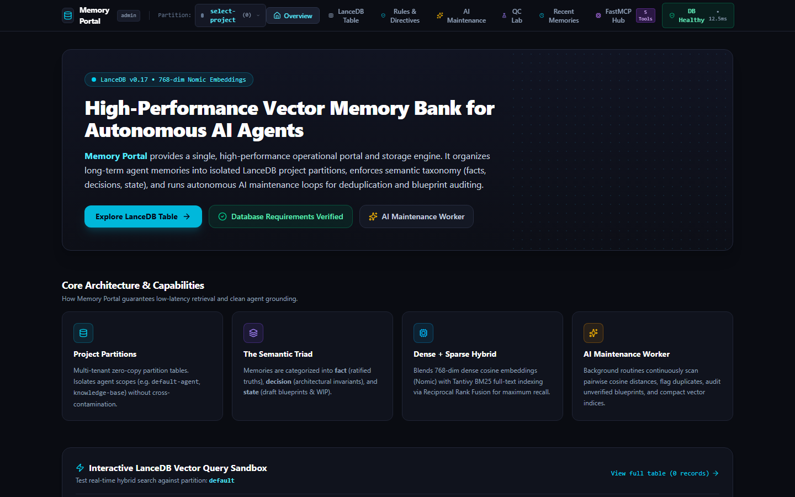
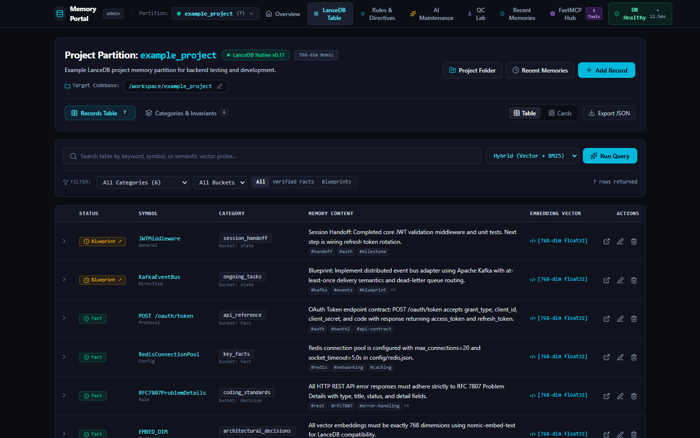

<h1 align="center">Lance Memory</h1>

<p align="center">
  <strong>Persistent, project-scoped memory for AI agents. Local-first, backed by LanceDB, with five tools.</strong>
</p>

<p align="center"></p>

<p align="center">
  <a href="https://github.com/Flambeau-Phoenix/lance-mem0ry/actions/workflows/ci.yml"></a>
  <a href="LICENSE"></a>
  
  
  
</p>

Lance Memory (`lance-mem0ry`) gives coding agents a durable memory that survives
sessions. Embeddings are generated locally through Ollama, so no paid vector database or
embedding API is required. The design is heavily inspired by
[mem0](https://github.com/mem0ai/mem0), adapted for LanceDB.

It ships as several pieces that share the same storage:

| Piece | What it is | Start it with |
|---|---|---|
| **MCP server** | FastMCP server exposing exactly **five** routed tools; the main way agents use Lance Memory | `python server/memory_server.py` |
| **Python library** | `lance_memory`: a Mem0-style `LanceMemory` API (add, search, update, delete, history) | `from lance_memory import LanceMemory` |
| **REST API** | FastAPI wrapper around the library | `lance-memory-api` |
| **Admin console** | Streamlit UI for categories, project provisioning, migration and maintenance | `streamlit run server/admin_app.py` |
| **Web panel** | React and Vite UI (see [`web-panel/`](web-panel/README.md)) | `npm run dev` in `web-panel/` |
| **Claude Code hooks** | Load recent memory at session start; checkpoint at compaction and session end | [`templates/hooks/`](templates/hooks/README.md) |

<p align="center">
  <br>
  <em>The web panel on a fresh install: no projects, memories or sample data.</em>
</p>

**Contents:**
[Features](#features) ·
[Quickstart](#quickstart) ·
[Network exposure](#network-exposure) ·
[Claude Code hooks](#claude-code-hooks) ·
[The five tools](#the-five-mcp-tools) ·
[Immutable memories](#immutable-memories-library) ·
[Categories](#category-governance--agent-lifecycle) ·
[Admin console](#admin-console) ·
[Configuration](#configuration-reference) ·
[Layout](#repository-layout) ·
[Development](#development) ·
[License](#license)

## Features

- **Zero-cost primary path.** 768-dimensional embeddings generated locally via Ollama
  (`nomic-embed-text`). No cloud dependency.
- **Strict project partitioning.** Memories belong to isolated project partitions
  configured on the host (for example a repository or system name). Agents discover
  routing profiles with `inspect_memory_system(action="projects")`; an authorized
  `lance_memory_project_id` in the nearest `AGENTS.md` takes precedence, otherwise they
  choose the best contextual fit. Folder names need not match partition IDs. Agents are
  **forbidden from creating project IDs**; administrators provision partitions through
  the admin console or CLI.
- **Enforced category registry.** Every project keeps a `categories.json` catalog.
  Agents read the category descriptions via `inspect_memory_system(action="categories")`
  to decide where each memory belongs.
- **Verified versus blueprint guardrail.** Drafts and work-in-progress hypotheses are
  stored as `verified=false`; only proven, tested work and ratified decisions can be
  promoted to `verified=true`.
- **Five-tool MCP surface.** `recall`, `commit_memory`, `modify_memory`,
  `sync_session_buffer`, `inspect_memory_system`. No wall of 20+ tools; each routes
  internally by parameter.
- **Blank slate.** A fresh install contains no projects, memories or sample data.
- **Claude Code hooks.** Load recent project memory at session start and checkpoint at
  compaction and session end. See [Claude Code hooks](#claude-code-hooks).

## Quickstart

Requirements: Python 3.11 or newer and [Ollama](https://ollama.com). Python 3.11, 3.12,
3.13 and 3.14 are tested in CI. The hook script alone only needs Python 3.10+.

**1. Install**

```bash
python -m venv .venv && . .venv/bin/activate      # Windows: .venv\Scripts\activate
pip install -e ".[admin]"                         # [admin] adds Streamlit for the console
```

**2. Start local embeddings**

```bash
ollama pull nomic-embed-text
ollama serve
```

**3. Run the MCP server**

```bash
export PROJECT_MEMORIES_ROOT=./project_memories
python server/memory_server.py          # http://127.0.0.1:8768/mcp
```

**4. Launch the admin console**

```bash
streamlit run server/admin_app.py --server.port 8767 --server.address 127.0.0.1
```

Use **➕ Provision New Project** in the sidebar to create your first project partition.
Then point your agent at the server by copying `templates/.mcp.json`,
`templates/AGENTS.md` and `templates/skills/lance-memory-governance/` into your project.

## Network exposure

The server and consoles have **no built-in authentication**, so everything binds to
`127.0.0.1` by default. Reaching them from another machine is an explicit opt-in:

```bash
export LANCE_MEMORY_HOST=0.0.0.0        # or a specific LAN address
```

The server prints a warning at startup when it listens on anything other than loopback.
Only do this on a trusted network, or put the services behind a reverse proxy with TLS
and authentication, a VPN or a firewall. The REST API (`lance-memory-api`, loopback on
port `8769`) honours a bearer token: set `LANCE_MEMORY_TOKEN` before exposing it. See
[SECURITY.md](SECURITY.md) for the full guidance.

## Claude Code hooks

Memory only helps if the agent consults it. The hooks in
[`templates/hooks/`](templates/hooks/README.md) do that automatically:

| Event | Behavior |
| --- | --- |
| `SessionStart` | Loads the project's most recent notes into the session and names the `project_id` to use |
| `PreCompact`, `SessionEnd` | Writes a small, deterministic, unverified checkpoint (time, branch, commit, clean or dirty tree; never prompts or file contents) |

It is one standard-library Python file that fails soft: if the server is down it exits
quietly and never blocks a session. Setup takes three steps, a file copy, a settings
merge and a `lance_memory_project_id` line in `AGENTS.md`. Full instructions, settings
and safety notes: [templates/hooks/README.md](templates/hooks/README.md).

## The five MCP tools

| Tool | Purpose | Key parameters |
|---|---|---|
| `recall` | Search or browse memories | `search_type`: `semantic` \| `symbol` \| `recent` \| `id` |
| `commit_memory` | Write discoveries, handoffs, promotions | `type`: `discovery` \| `handoff` \| `promotion` |
| `modify_memory` | Update, delete, archive or purge memories | `action`: `update` \| `delete` \| `archive` \| `purge` |
| `sync_session_buffer` | Short-lived multi-turn working memory | `action`: `begin` \| `read` \| `write` \| `flush` |
| `inspect_memory_system` | Project discovery, health, stats, maintenance, history, categories | `action`: `projects` \| `health` \| `stats` \| `maintenance_scan` \| `history` \| `categories` |

Agents query valid categories and read their descriptions before recording memories:

```python
inspect_memory_system(action="categories", project_id="<PROJECT_ID>")
```

Full tool and schema reference: [docs/MEMORY_SYSTEM_REFERENCE.md](docs/MEMORY_SYSTEM_REFERENCE.md).

The library also installs a separate MCP entry point, `lance-memory-mcp`, that exposes
the Mem0-style API directly (about twenty fine-grained tools). The five-tool server above
is the one the templates, hooks and documentation target.

## Immutable memories (library)

In the Python library, `add(..., immutable=True)` protects a memory from updates,
deletion and automatic mutations such as supersession:

- `update()` and `delete()` raise `ImmutableMemoryError` (a `ValueError` subclass).
- `batch_update()`, `batch_delete()`, `delete_all()` and `delete(..., delete_linked=True)`
  skip protected rows and report only what actually changed.
- Over REST, `PATCH` and `DELETE` on an immutable memory return HTTP 404 with an
  "immutable" detail.

## Category governance & agent lifecycle

Every project partition contains a `categories.json` registry defining approved
categories, their semantic bucket (`fact`, `decision`, `state`) and a human- and
agent-readable description.

| Category | Bucket | Verified | Description and lifecycle rule |
|---|---|---|---|
| `key_facts` | `fact` | `true` | Ratified facts, verified patterns, stable APIs and configuration constants (after proof). |
| `architectural_decisions` | `decision` | `true` | System architecture, design choices, invariants, patterns and trade-offs. |
| `ongoing_tasks` | `state` | `false` | Work-in-progress blueprints, hypotheses and pending implementation steps. |
| `session_handoff` | `state` | `false` | Session summaries, milestones reached and next action items. |

Administrators can add project-specific categories in `categories.json` or through the
admin console. The agent charter and workflow (before, during, after proof, handoff)
live in [`templates/AGENTS.md`](templates/AGENTS.md).

## Admin console

<p align="center">
  <br>
  <em>A project in the web panel: the bundled <a href="examples/">example project</a> with its records, categories and verified/blueprint status.</em>
</p>

The Streamlit console (`server/admin_app.py`, default port `8767`) provides:

1. **Category management.** A per-project catalog with descriptions, buckets and live
   record counts; add, edit, rename (with cascading record updates) and safely delete
   categories; and a cross-project **migrate or copy** tool that rebuilds full-text
   indexes and tags provenance.
2. **Project provisioning.** One-click scaffolding of clean LanceDB partitions with
   full-text indexes and default category registries.
3. **Safe vector serialization.** A built-in `NumpyEncoder` handles 768-dimensional
   NumPy vectors without JSON crashes during export and inspection.
4. **Maintenance and deduplication.** Pairwise cosine-distance scans (distance < 0.15).

The MCP server also hosts a lighter built-in panel and REST routes on `:8768`. Backend
and API details: [docs/WEB_PORTAL_BACKEND_REQUIREMENTS.md](docs/WEB_PORTAL_BACKEND_REQUIREMENTS.md).
Operations, backup and maintenance: [docs/RUNBOOK.md](docs/RUNBOOK.md).

## Configuration reference

| Environment variable | Default | Purpose |
|---|---|---|
| `PROJECT_MEMORIES_ROOT` | `./project_memories` | Root directory containing project partition folders |
| `PROJECT_MEMORY_PROJECTS` | discovered directories | Optional comma-separated authorized or pre-seeded partitions; omit for a blank slate |
| `OLLAMA_HOST` | `http://127.0.0.1:11434` | Ollama embedding endpoint |
| `LANCE_MEMORY_TRANSPORT` | `http` | FastMCP transport (`http`, `sse` or `stdio`) |
| `LANCE_MEMORY_HOST` | `127.0.0.1` | MCP server bind host; widen only on a trusted network (`ARCH_MEMORY_HOST` is a deprecated fallback) |
| `LANCE_MEMORY_PORT` | `8768` | MCP server HTTP port |
| `LANCE_MEMORY_API_HOST` | `127.0.0.1` | REST API (`lance-memory-api`) bind host |
| `LANCE_MEMORY_API_PORT` | `8769` | REST API port |
| `LANCE_MEMORY_TOKEN` | none | Bearer token the REST API requires when set |
| `HOST` / `PORT` | `127.0.0.1` / `3000` | Web panel (`web-panel/`) bind address and port |
| `EXTRACTION_LLM_URL` | none | Optional OpenAI-compatible endpoint for memory extraction |
| `LANCE_MEMORY_LLM_PROVIDER` | `ollama` | LLM provider (`openai_compatible` for HTTP proxies; legacy `butter` still accepted) |

See [`.env.example`](.env.example) for the full list. Copy it to `.env` and never commit
real secrets.

> **Deprecated fallbacks:** `ARCH_MEMORY_*` and `BUTTER_*` are still read when the
> canonical `LANCE_MEMORY_*` and `EXTRACTION_LLM_*` variables are unset. Prefer the
> canonical names.

### Health check and verification

1. **Health.** Call `inspect_memory_system(action="health")` and confirm Ollama and
   LanceDB report healthy.
2. **Projects.** Call `inspect_memory_system(action="projects")`.
3. **Categories.** Call `inspect_memory_system(action="categories", project_id="<PROJECT_ID>")`.
4. **Smoke test.** `bash server/scripts/acceptance_smoke.sh`

## Repository layout

```text
lance-mem0ry/
├── docs/                      Backend spec, tool/schema reference, operations runbook
├── examples/                  Example LanceDB partition, tarball and JSON export (synthetic vectors)
├── server/
│   ├── memory_server.py       FastMCP server (recall, commit, inspect, ...)
│   ├── admin_app.py           Streamlit admin console
│   ├── admin_cli.py           Backup, audit and maintenance CLI
│   ├── static/index.html      Built-in lightweight web panel
│   └── scripts/               Smoke test, nightly maintenance, migrations
├── src/lance_memory/          Core library, REST API and `lance-memory-mcp` entry point
├── systemd/                   Example service and timer units (loopback by default)
├── templates/                 Drop into any project repository:
│   ├── .mcp.json              MCP endpoint configuration
│   ├── AGENTS.md              Agent governance charter
│   ├── skills/                Agent skill definition (lance-memory-governance)
│   └── hooks/                 Claude Code hooks (session-start recall, checkpoints)
├── web-panel/                 React and Vite admin UI with an Express dev server
├── tests/                     Pytest suite
├── .github/                   CI workflows, issue and pull-request templates, Dependabot
├── .env.example               Annotated environment template
└── pyproject.toml
```

## Development

```bash
pip install -e ".[dev]"
python -m pytest                       # full suite; run from the repository root
python -m pytest tests/test_hooks.py   # hook tests only; no LanceDB or Ollama needed
ruff check path/to/changed_file.py
```

The web panel has its own checks:

```bash
cd web-panel && npm ci && npm run lint && npm run build
```

CI (`.github/workflows/ci.yml`) runs the full Python suite on Python 3.11 to 3.14 and the
web-panel type-check and build; a separate workflow runs the hook tests on Python 3.10
and newer. `ruff` is configured in `pyproject.toml`; the existing code has known
findings, so please keep the files you touch clean rather than expecting a clean
repository-wide run.

Contributions are welcome: see [CONTRIBUTING.md](CONTRIBUTING.md) and the
[code of conduct](CODE_OF_CONDUCT.md). Report security issues privately as described in
[SECURITY.md](SECURITY.md). Release history: [CHANGELOG.md](CHANGELOG.md).

## License

Apache-2.0. See [LICENSE](LICENSE). Copyright 2026 LanceMemory Contributors.
