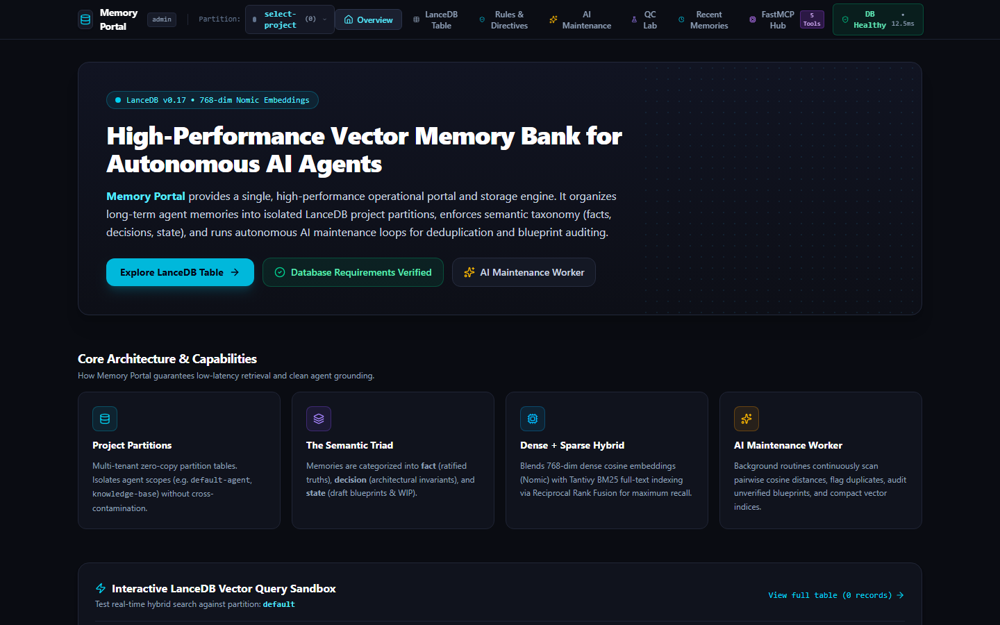
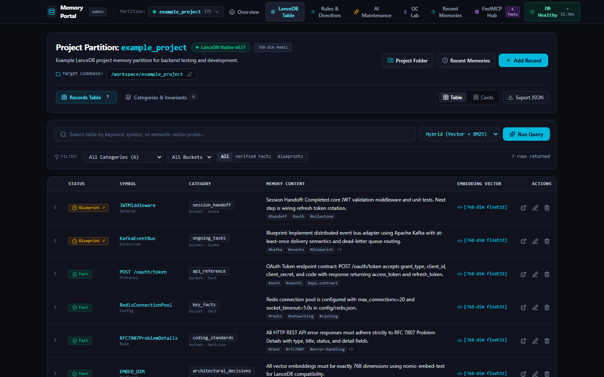

# Lance Memory — Web Panel

React + Vite admin UI for Lance Memory (project partitions, LanceDB table explorer,
maintenance/dedup lab, FastMCP hub).



*A fresh install: no projects, memories or sample data.*



*A project in the panel: the bundled [example project](../examples/README.md) loaded into the table view.*

## Prerequisites

- Node.js 20+
- Lance Memory HTTP/MCP server (default `http://127.0.0.1:8768`) or the Express
  mock/dev server bundled here

## Setup

```bash
cd web-panel
cp .env.example .env.local   # optional
npm install
npm run dev
```

## Scripts

| Script | Purpose |
|---|---|
| `npm run dev` | Dev server (`tsx server.ts`) |
| `npm run build` | Production Vite + bundled server |
| `npm start` | Run built `dist/server.mjs` |
| `npm run lint` | Typecheck |

## Environment

See [`.env.example`](./.env.example). Do not commit real API keys.

The panel has no authentication, so it listens on `127.0.0.1:3000` by default. Set
`HOST=0.0.0.0` (or a LAN address) and `PORT` to change that, only on a trusted network or
behind your own access controls.